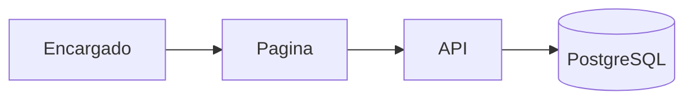
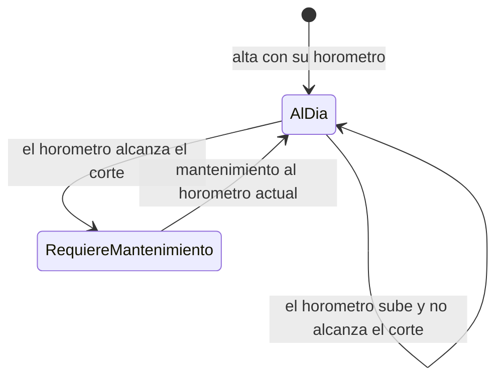
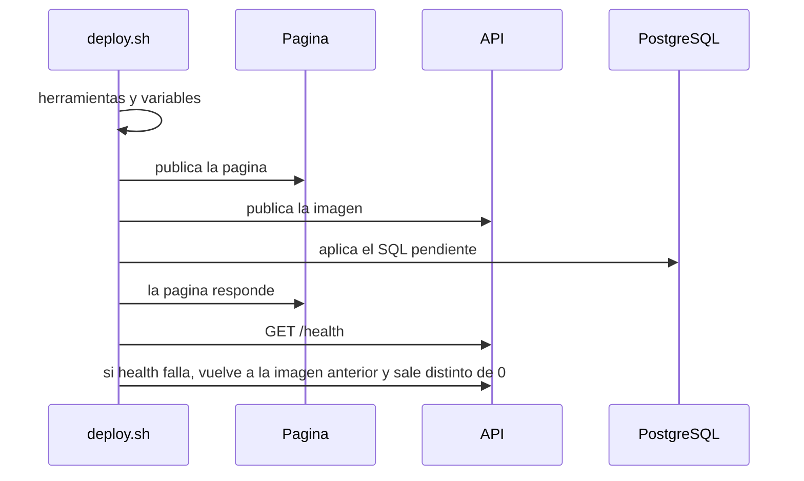

# ARCHITECTURE — Tajo

Estado: Aprobada
Fecha: 2026-11-11

Este documento manda sobre el código de esta versión. Las decisiones caras de revertir están en [los ADR](../adr/README.md). El vocabulario está en [el glosario](../../GLOSSARY.md). El criterio de cada pieza está en [STACK](STACK.md).

## Qué es

Tajo es el patio de equipos de un tajo. El encargado ve quién requiere mantenimiento, anota horas y deja constancia cuando mantiene una máquina.

La página y la API son dos procesos, con dos URLs. La página no calcula el ciclo. La API lo calcula al leer. [ADR-0001](../adr/0001-el-horometro-no-se-reinicia.md). [ADR-0002](../adr/0002-un-repositorio-dos-urls.md).

## Ciclo

El listado pone primero a quien requiere mantenimiento.

## Publicación

La segunda corrida no repite una migración ya aplicada. La vuelta atrás no toca el esquema. [ADR-0003](../adr/0003-la-migracion-solo-agrega.md). [ADR-0005](../adr/0005-el-despliegue-es-un-comando.md).

## Límites

No hay login. Quien tiene las URLs opera el patio. [ADR-0004](../adr/0004-el-patio-no-tiene-login.md).
